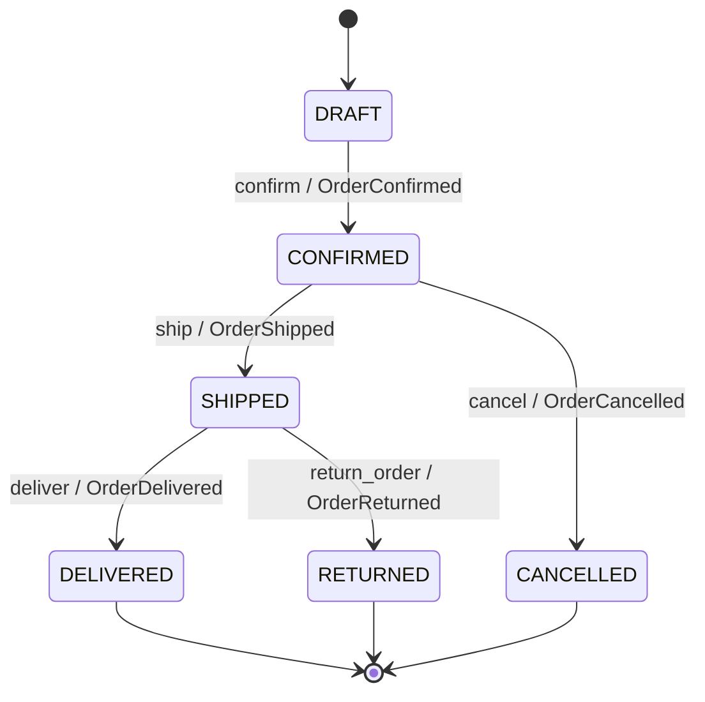

# TechStore U4 – Núcleo de negocio (DDD)

Práctica guiada · Actividad 4 · Componentes de Lógica de Negocio (FIME-UANL).
Pedidos con Value Objects, Aggregate Root, Specification Pattern, máquina de estados con
Domain Events y API REST con FastAPI. Todo en memoria (sin base de datos ni inventario).

## Estructura

```
techstore-u4/
  datos/            clientes.csv, productos.csv, pedidos.csv, detalle_pedidos.csv, escenarios.csv
  cargar_csv.py     cargador de fixtures (no se modifica)
  ejecutar_escenarios.py   corre E01-E15 e imprime la tabla
  pytest.ini
  app/  __init__.py, domain.py, specifications.py, api.py
  tests/ test_domain.py, test_api.py
  BITACORA.md       bitácora de los escenarios E01-E15
```

## Instalación (Python 3.11+)

```
python -m venv .venv
.venv\Scripts\activate          # Windows   (Linux/Mac: source .venv/bin/activate)
pip install fastapi uvicorn pytest httpx
```

## Ejecución

| Qué | Comando |
|---|---|
| Cargar los 16 pedidos | `python cargar_csv.py` |
| Escenarios E01–E15 | `python ejecutar_escenarios.py` |
| Pruebas | `python -m pytest -q` |
| API | `uvicorn app.api:app --reload` → http://127.0.0.1:8000/docs |

Ejecuta todo desde la carpeta raíz (donde está `cargar_csv.py`). El contrato OpenAPI está en
http://127.0.0.1:8000/openapi.json. El repositorio es en memoria: al reiniciar la API los pedidos
vuelven a DRAFT.

## Reglas de negocio

- **Money:** `Decimal` (nunca `float`), MXN, inmutable; rechaza negativos y no finitos; `add()` rechaza monedas distintas y devuelve un objeto nuevo.
- **OrderItem:** sku no vacío, cantidad > 0, subtotal = precio × cantidad.
- **Límite:** máximo **20 unidades** por pedido (suma de cantidades, no de renglones). `add_item` solo en DRAFT y falla antes de modificar.
- **Descuento 10 %:** cliente VIP **y** total > 500 **y** unidades ≥ 4 **y** sin promoción.
- **Descuento 5 %:** total > 5000 **y** sin promoción. Si se cumplen ambos, aplica 10 %.
- **Transiciones:** `confirm` (DRAFT; requiere artículos y cliente activo), `ship(guía)` y `cancel(motivo)` (CONFIRMED; texto no vacío), `deliver` y `return_order` (SHIPPED).
- **Orden en cada transición:** validar → cambiar estado → registrar evento. Una operación inválida no cambia nada.
- **Eventos:** OrderConfirmed, OrderShipped, OrderCancelled, OrderDelivered, OrderReturned (con `order_id` y hora UTC).
- **Excepciones:** `DomainException` ← `InvalidOrderData`, `InvalidOrderTransition`, `OrderItemLimitExceeded`.

## Endpoints

| Método y ruta | Cuerpo | Respuestas |
|---|---|---|
| `GET /orders/{id}` | — | 200, 404 |
| `POST /orders/{id}/confirm` | — | 200, 404, 409, 422 |
| `POST /orders/{id}/ship` | `{"tracking": "GUIA-123"}` | 200, 404, 409, 422 |
| `POST /orders/{id}/cancel` | `{"reason": "texto"}` | 200, 404, 409, 422 |

404 = pedido no existe · 409 = `InvalidOrderTransition` (estado incorrecto) · 422 = `InvalidOrderData` (pedido vacío, cliente inactivo, guía o motivo vacíos).
Los endpoints no validan reglas: llaman al dominio y traducen sus excepciones.

## Diagrama de estados


